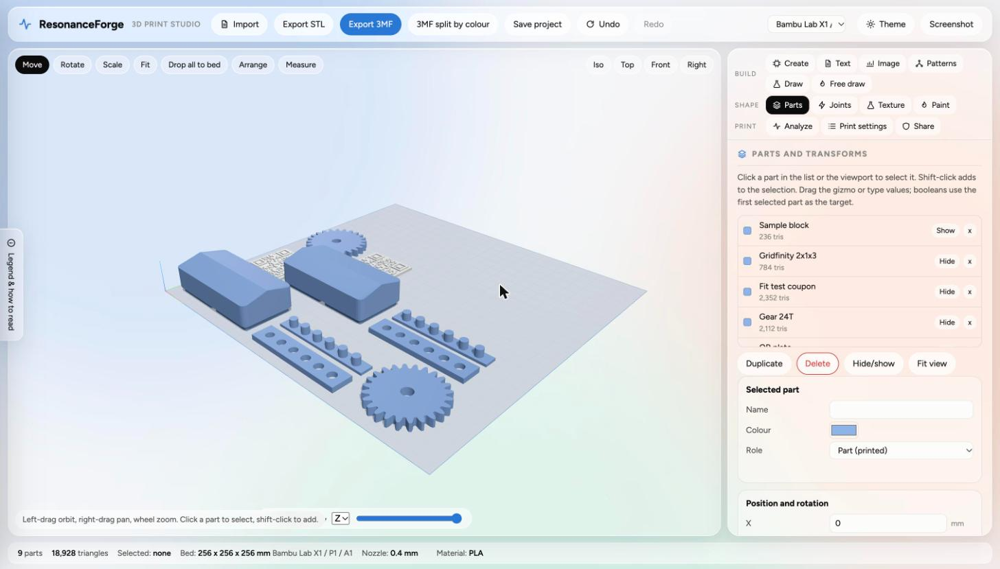

# ResonanceForge

> A self-contained 3D printing studio in the browser: model, texture, joint, analyse and prepare parts, then export STL / 3MF.

A self-contained 3D printing toolbox that runs in your browser from a local server. No accounts, no cloud, no data leaves your machine.



## What it does

| Panel | Tools |
|---|---|
| **Parts** | Part roles (part, negative, modifier) with **Combine by role** to bake custom parts; linear / grid / polar **arrays**, align and distribute, **auto-orient** for least support, **deformers** (twist, taper, bulge, bend, jitter), **shell / hollow** with open side and drain holes, surface offset, **round all edges**, mirror copy, **split by part**, **snap onto a surface**, arrow-key nudging; import STL / 3MF / OBJ, move / rotate / scale with a gizmo or typed values, drop to bed, lay flat, mirror, duplicate, boolean union / subtract / intersect, repair (reweld), simplify, refine, convex hull, split shells, flip normals, volume and weight estimate |
| **Create** | Box, rounded box, cylinder, cone, sphere, torus, tube, wedge, involute spur gear, hex prism, star, pyramid, prism, ellipsoid, capsule, dome, arch, spring, heart, bolt and nut (real threads), knurled knob, icosahedron, dodecahedron, pipe elbow, rounded puck, rounded plate, slot, elliptical cylinder, hollow sphere, gear rack, GT2 pulley, chamfered box, teardrop, U channel, L and T profiles, rectangular tube, **Gridfinity bins and baseplates**, a **fit-test coupon**, calibration and utility presets, and parametric **prefabs**: chest with hinged lid and latch, jar with screw lid, vented basket with screw lid, divider tray, sliding-lid box, holder block, planter with saucer, phone stand, wall hook, battery tray, funnel, pencil cup, shelf bracket, electronics enclosure with standoffs, drawer unit, C-clamp with threaded screw, spool holder, fidget spinner, d6 dice, spoked wheel, pegboard hook, soap dish, cable comb, twisted vase, perforated lampshade, toolbox with handle, honeycomb storage wall tile and twist-lock hook, magnet-latched box, friction-lid box, living hinge strip, picture frame with stand, headphone stand, cord winder, plant label, tea light holder, business card holder, mug with handle, bowl, cable clip, stackable parts bin, paint palette, ruler with engraved ticks, SD card holder, toothbrush holder, D-shaft control knob, bag clip, door wedge with knurl, double coat hook, desk cable grommet. Every shape (and text) can be added as a new part, fused into the selected part, cut from it, or attached as an editable **negative part** or **modifier** |
| **Draw** | Draw straight onto the 3D part: in Auto mode every stroke lands on the face under the cursor (top, side, bottom, any angle), or lock a plane preset (top / bottom / front / back / left / right) and tilt, spin or offset it for diagonals. Freehand, polygon, rectangle, circle, ring and stroked lines with grid snap and hole flags; shapes on different faces mix in one sketch. The solid forms live while you drag (green = add, red = cut), optionally previewed combined with the part. Edit points by dragging handles (Alt+click removes, Shift+click inserts) or typing coordinates. Camera stays free: right-drag orbit, middle-drag pan, Space + left-drag orbit |
| **Text** | Any TTF / OTF font (five bundled), multi-line, letter spacing, raised / engraved / stencil plates, keychain with ring, emboss or engrave onto an existing part, **curved text** on an arc with disc or ring bases (coins, badges), **QR code plates** |
| **Image** | Relief heightmap, lithophane (flat or **curved**), silhouette extrusion with threshold / simplify / smoothing, cookie cutter with blade and flange, and **image as surface texture** (logo or photo embossed onto any part, tiled or centred) |
| **Patterns & SVG** | Twenty procedural patterns with ready presets (oak and pine wood grain, cedar planks, knit, chunky knit, leather, carbon fibre, hammered metal, basket weave, ripples, flagstone, honeycomb, knurl...) exported as vector SVG or PNG heightmap, printed as textured tiles, cut as **perforated panels** or straight through a part, and SVG import to extruded solid |
| **Texture** | Apply any pattern as real surface displacement with planar, cylindrical or tri-planar mapping, face masks, pattern softening and Taubin mesh relaxation. The Patterns panel can apply its current pattern directly |
| **Free draw** | A 3D brush (round tube, square tube or flat ribbon) you drag through the air or across parts: strokes follow the surface, then continue at that depth on a camera-facing or world plane. Freehand, straight, circle / ring and rectangle frame, filled discs and plates, stroke smoothing, live preview; edit points with 3D handles or a coordinate table, move / rotate / scale strokes, align them to a world plane or the camera, flip, centre; build as fused, new, negative or modifier. Orbit to a side view and draw a vertical keyring loop straight onto a part |
| **Paint** | Brush, single triangle, flood fill and whole-part colouring; exported to 3MF per triangle or split into one object per colour for multi-material slicers |
| **Joints** | Pegs, square keys, dowels, dovetails, snap-fit clips, heat-set insert bosses, screw holes with countersink, magnet pockets, print-in-place and pin hinges, puzzle tabs; click a surface to fuse or cut them with a chosen fit tolerance. **Smart joints** fuse the peg on one part and cut the matching socket into the part it meets in one click. **Cut part with joint** splits a part on an editable plane (live preview) and places pegs, keys, dowels, a **screw-on helical thread** (male stud + female socket) or **aligned magnet pockets** with hidden floors across the cut. **Hinge and latch** builds a print-in-place barrel hinge between two parts on a chosen side plus a snap latch opposite. Smart magnet pockets mirror into the mating part |
| **Analyze** | Printability map (wall thickness, overhangs, per-layer load), layer charts, hotspot list with advice, and a voxel finite-element stress solve (gravity, top press or side push) with von Mises colour map |
| **Settings** | Printer presets (Bambu, Prusa, Creality, Anycubic Kobra 2 / 3 / S1, Elegoo, Voron, custom), nozzle, twelve material profiles with temperatures, cooling, drying and notes; part-aware layer height / walls / infill / supports / brim recommendation with filament and cost estimate, copy as text or JSON |
| **Market** | One-box search across MakerWorld, Printables, Thingiverse, Thangs, Cults3D, MyMiniFactory, Yeggi and more, plus a publishing checklist |

Viewport extras: Iso / Top / Front / Right views, a two-point **measure** tool that can also **scale a part so the measured distance becomes a typed value** (fix scans and unitless downloads), an **explode** toggle for assemblies, and a **section view** clipping slider to look inside parts. The session **autosaves** to the browser and offers to restore on the next visit; theme, printer, nozzle and material are remembered. Parts > **Scale to fit bed** shrinks oversized imports. **Save project** writes a 3MF with every part and its role so you can reload and keep working.

Export STL (binary), 3MF (units, multiple objects, colours) or a **ZIP with one STL per part** at any time. Negative parts are subtracted on export; modifiers export as their own `[modifier]` object so the slicer can assign per-region settings. The left-edge **Legend & how to read** drawer explains every colour, score and term.

Panels are grouped as **Build** (Create, Text, Image, Patterns, Draw, Free draw), **Shape** (Parts, Joints, Texture, Paint) and **Print** (Analyze, Print settings, Share).

## Use it online

The app is published with GitHub Pages at **https://ravendistrobution.github.io/resonanceforge/** and runs entirely in your browser (no server, nothing uploaded). In Chrome or Edge, use the address bar's install icon to add it as a desktop app; it keeps working offline after the first visit. Every push to `main` redeploys it.

## Quick start (run locally)

Requirements: a current browser (Chrome, Edge, Firefox or Safari). The launchers install [Node.js](https://nodejs.org) LTS for you if it is missing.

**macOS / Linux**

```bash
./start.sh
```

**Windows**

1. Download the repo (Code > Download ZIP, or `git clone https://github.com/RavenDistrobution/resonanceforge.git`) and unzip it.
2. Double-click `start.bat`. It installs Node.js LTS if it is missing (via winget, or the official installer with a permission prompt), installs the packages on the first run, then opens your browser at http://127.0.0.1:5180.

If Windows SmartScreen or Defender asks, allow the script: it only runs `npm install` and the local dev server. Use Chrome or Edge for the fastest geometry engine.

On macOS the script installs Node via Homebrew or the official package if needed. The first run installs dependencies. The script checks that the port is free, offers to clear it or pick the next free one, then opens `http://127.0.0.1:5180`. Set `PORT=6000` (or any number) before running to use a different port.

Production build (static files you can host anywhere or open with any static server):

```bash
npm run build      # writes dist/
npm run preview    # serves dist/ locally
```

## How the engine works

- **Geometry kernel**: [Manifold](https://github.com/elalish/manifold) (WebAssembly) for robust booleans, offsets, extrusions, hulls, slicing and refinement. Every generated part is guaranteed watertight.
- **Viewer**: [three.js](https://threejs.org) with a Z-up print bed, orbit controls and a transform gizmo.
- **Fonts**: [opentype.js](https://opentype.js.org) parses TTF / OTF outlines; glyphs become Manifold cross-sections with correct holes.
- **Analysis**: [three-mesh-bvh](https://github.com/gkjohnson/three-mesh-bvh) for ray casting (wall thickness, voxelisation). The FEA assembles 8-node hexahedral elements from the voxel grid and solves with a Jacobi-preconditioned conjugate gradient, all in the browser.
- **Files**: STL / 3MF / OBJ loaders from three.js; the 3MF writer emits the core and materials extension (per-triangle colour groups) and is zipped with fflate.

## Scripting

The page exposes `window.resonanceforge` with `project`, `viewer`, `ctx` and `THREE` so you can drive the scene from the browser console (for example `resonanceforge.project.parts`).

## Keyboard

In tool modes (draw, paint, place): right-drag orbits, middle-drag pans, wheel zooms, `Space` + left-drag orbits. Arrow keys nudge the selection 1 mm (`Shift` 10 mm, `Alt` 0.1 mm), `PageUp` / `PageDown` for Z. `W` move, `E` rotate, `R` scale, `F` fit view, `Delete` remove, `Ctrl/Cmd+Z` undo, `Ctrl/Cmd+Shift+Z` redo, `Ctrl/Cmd+D` duplicate, `Shift+click` add to selection, `Esc` clear selection or cancel placement. Drag and drop files onto the viewport to import.

## Limits worth knowing

- Imported meshes that are not watertight become "mesh-only" parts. They can be moved, painted, analysed and exported, but booleans and textures need a successful **Repair** first.
- The stress tools are estimates for deciding where to add supports, walls or material. They are not a substitute for engineering analysis.
- Voxel FEA cost grows with resolution cubed. 24 cells is interactive; 40 or more can take tens of seconds on large parts.
- Relief meshes are dense (two triangles per pixel). Lower the resolution slider for very large images.

## Project layout

```
index.html            app shell
src/main.ts           boot, top bar, tabs, shortcuts
src/core/             manifold bootstrap, geometry conversion, project model, importers, exporters
src/tools/            primitives, text, image, patterns, texture, joints, stress analysis
src/ui/               DOM helpers, charts, legend drawer, panels/
src/data/materials.ts filament, printer and marketplace reference data
src/styles/           liquid glass theme tokens and app layout
public/fonts/         bundled OFL fonts (TTF for 3D text, WOFF2 for UI)
start.sh / start.bat  launchers with port handling
```

## Authorship

Designed and authored by MB. Distribution: RavenDistro. The signature in `NOTICE` and `src/brand/brand.ts` ships with every copy; the app verifies it at start-up and writes it into every exported STL and 3MF. There is an easter egg; try the Konami code.

## Licence

**Non-commercial.** Free to use, modify and share for personal, educational and research use. No sale of the software or anything that bundles it, no patent or trademark claims over it, keep the notice and signature. Objects you print are yours. See `LICENSE`. Bundled fonts are under the SIL Open Font License (see `public/fonts/OFL.txt`).
